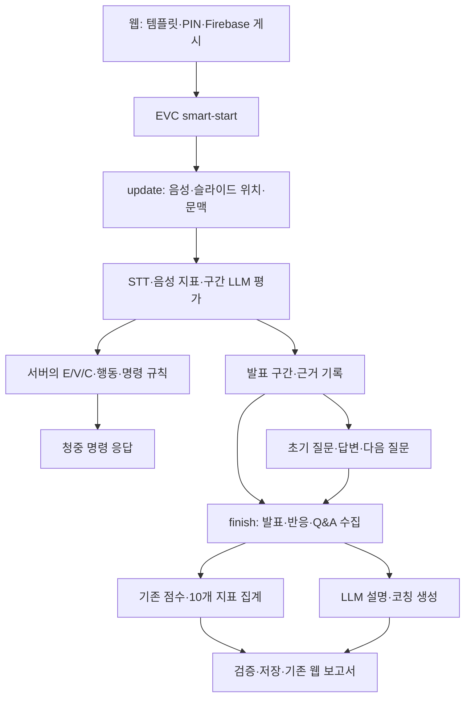
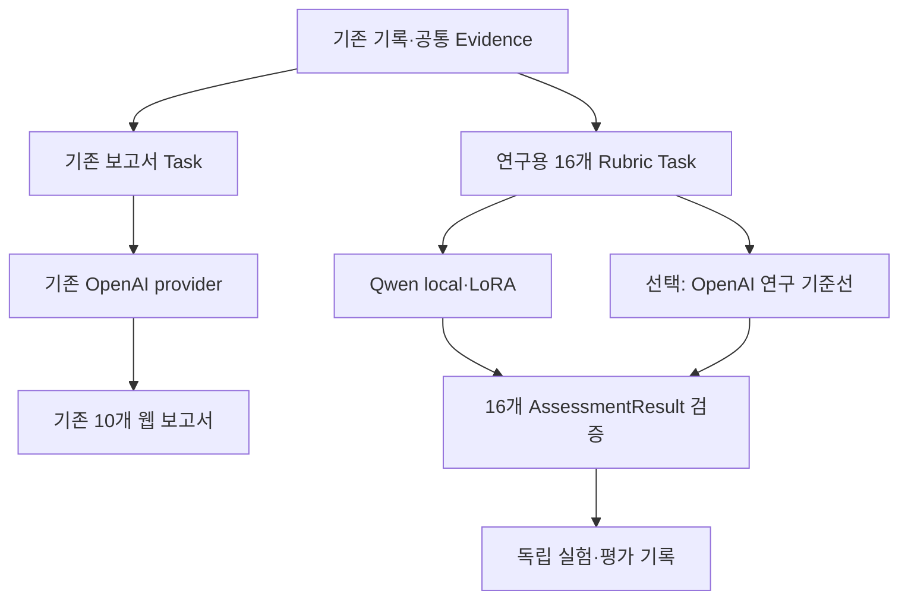

# Notion 원본 스냅샷

출처: https://app.notion.com/p/3fadfd91e6c681a2a8d4c1fe9da8b3c9?pvs=204

마지막 편집: 2026-10-15T03:17:14.588Z

수집일: 2026-10-15. 아래는 Notion enhanced Markdown이며 원본 table/mention 표기를 보존했다.

<callout icon="🎯" color="blue_bg">
	**목표: 기존 필드·재생·웹 규칙을 유지하며 연구용 Qwen 모듈을 분리한다.** 청중 수는 기존 설정값 `audience_count=a`에 맞춰 백엔드의 6명 고정을 해제하도록 설계를 정정한다. Unity·웹 코드 변경은 요구하지 않는다.
</callout>
**분석 기준:** 첨부 sushisite(2).zip · <mention-date start="2026-10-15"/>. 아래에서 ‘현재’는 첨부 코드에서 확인한 내용, ‘설계’는 앞으로 구현할 변경을 뜻한다. 이번 작업은 코드 분석·노션 작성이며 코드 수정·폴더 삭제를 실행하지 않았다.
## 먼저 확인한 결론
1. **청중 수 입력은 이미 있다.** 웹에서 1–50명을 선택해 template snapshot과 Firebase에 전달하지만, EVC가 count를 읽지 않아 항상 6명으로 초기화한다. 기존 입력을 세션까지 연결하는 백엔드 수정이 필요하다.
2. **Qwen은 연구계획의 16개 Rubric 채점 모듈이다.** 기존 OpenAI의 10개 보고서 설명을 먼저 재현할 필요가 없다. 앞선 문서의 ‘10개 설명 교체부터 진행’ 전제를 철회한다.
3. **30초 단위 수집과 분석 지연이 재생 시각에 반영되지 않을 수 있다.** 분석 전 client time에 .05/.10초만 더해 명령을 만들어 응답 도착 전에 시작 시각이 지날 수 있다. 독립 반응 모드도 오래된 이벤트·청중 수 증가에 대한 보완이 필요하다.
4. 기존 서비스 점수 집계·OpenAI 설명·질문은 유지하고, 연구 채점과 별도로 검증한다. 활성 통신은 HTTP + Firebase이며 첨부에는 Unity C# 소스가 없어 실제 XR 재생은 미검증이다.
**세부 근거:** <mention-page url="https://app.notion.com/p/3fadfd91e6c681c4a681f8833b1b31a4">코드 근거·입출력 계약·재현 결과</mention-page> — 파일·행 번호, 입출력 계약, 청중 수 전달 경로, 시간 불일치 재현과 과거 측정 결과.
<table_of_contents/>
## 1. 현재 전체 파이프라인

<table fit-page-width="true" header-row="true">
<tr>
<td>구간</td>
<td>실제 동작</td>
<td>주요 코드</td>
</tr>
<tr>
<td>준비</td>
<td>웹이 청중 수를 포함한 pre-session/PIN을 만들고 Firebase에 게시. 현재 smart-start는 그 수를 무시하고 청중 6명을 준비한다. 수정안은 snapshot의 수 a를 사용한다.</td>
<td>`odi/EVC/router.py` · `pipeline.py` · 웹 `session-materials.ts`</td>
</tr>
<tr>
<td>AI 청중</td>
<td>STT → 모델의 내용 4개·전달 2개 점수 → 음성·시선 점수 조립 → 상태 변화·행동 선택·UnityCommand 생성</td>
<td>`evaluation.py` → `state_engine.py` → `behavior_engine.py` → `command_builder.py`</td>
</tr>
<tr>
<td>독립 반응 모드</td>
<td>independent_reactions=true일 때 update는 분석만 하고 /reactions가 재생 명령을 만든다. 이 반응 시계에는 LLM/STT 호출이 없다.</td>
<td>`reaction_scheduler.py` · `router.py`</td>
</tr>
<tr>
<td>AI 질문</td>
<td>초기 질문 생성 → Azure TTS → 답변 STT → 다음 청중에 맞는 질문 교체. 총 질문 수를 늘리지 않는다. 마지막 답변 후 추가 생성은 없다.</td>
<td>`question_service.py` · `question_generation.py` · `answer_service.py` · `azure_speech.py`</td>
</tr>
<tr>
<td>평가·보고서</td>
<td>report_segments와 반응·Q&A를 모아 집계하고 LLM이 설명을 보완한다. PIN 연결 시 DB에 저장하고 웹은 기존 세션 조회 경로로 읽는다.</td>
<td>`report_v2/report_service.py` · `report_aggregation.py` · `report_generation.py`</td>
</tr>
</table>
기본 설정값은 구간 평가·보고서 설명이 gpt-4.1-nano, 질문이 gpt-4.1-mini다. 실제 배포 환경에서 어떤 값으로 덮어썼는지는 확인하지 않았다. 상위 `report_service.py` 등의 report 파일은 활성 report_v2를 가리키는 호환 진입점이다. 오래된 `service.py`·EVCv1·legacy_report_v1을 현재 구현으로 섞지 않는다.
## 2. 항목별 변경 범위
<table fit-page-width="true" header-row="true">
<tr>
<td>항목</td>
<td>이번 수정 방향</td>
<td>유지·보완할 것</td>
</tr>
<tr>
<td>AI 청중</td>
<td>**6명 고정 → 기존 입력 a명**</td>
<td>기존 template snapshot에서 count를 읽고 초기화·ID·검증·좌석·RNG·반응 스케줄러를 함께 일반화한다. E/V/C 식·catalog·명령 필드와 의미는 유지한다.</td>
</tr>
<tr>
<td>AI 질문</td>
<td>**현재 동작 유지**</td>
<td>질문 개수·순서·중복·적응형 생성·TTS 유지. 청중 ID 검증은 해당 세션의 a명 registry를 따른다. 청중 수와 질문 수는 다른 설정이다.</td>
</tr>
<tr>
<td>실시간 구간 평가</td>
<td>기본 OpenAI 유지</td>
<td>기존 SegmentEvaluationProvider 경계는 재사용 가능. 연구용 Qwen을 실시간 청중 제어에 자동 적용하지 않는다.</td>
</tr>
<tr>
<td>기존 보고서 설명</td>
<td>기본 OpenAI·10개 계약 유지</td>
<td>현재 ReportInsightProvider와 점수 집계를 유지한다. 이 설명 Task를 Qwen이 구현해야 한다는 선행 조건은 두지 않는다.</td>
</tr>
<tr>
<td>연구용 Qwen 채점</td>
<td>**독립 모듈로 구현·검증**</td>
<td>EvidencePack → 16개 Rubric·1–5점/null·이유·Evidence·평가 불가. 기존 10개 보고서 설명과 다른 Task·schema다.</td>
</tr>
</table>
### 2-1. 청중 수 a를 사용하는 백엔드 수정안
**전달 경로:** 웹의 `audience.audience_count` → pre-session `template_snapshot` → 현재 smart-start에서 누락. Firebase에는 이미 `page_3.audience_scale`로 게시된다. 새 프론트 입력을 만들 필요가 없다.
1. **입력 연결:** PIN에 묶인 snapshot의 count를 내부 `SmartStartOptions.audience_count`와 SessionRecord에 전달한다. 수정 가능한 최신 템플릿을 다시 읽지 않는다. 기존 PIN 없는 호출·count 누락은 6명을 기본값으로 둔다.
2. **검증:** 현재 웹 범위인 정수 1–50만 허용한다. 값이 있는데 bool·소수·잘못된 문자열·범위 밖이면 입력 오류로 처리한다. 소수를 int로 잘라 받거나 잘못된 값을 조용히 6으로 바꾸지 않는다.
3. **초기화·계약:** 6명 layout·특성 배열·RNG·노트북 청중 선택·응답 길이 검사를 a명으로 일반화한다. ID는 `audience_{i:02d}`의 01…a로 만들고, 명령·질문에서 실제 세션 registry 소속인지 검사한다. 다른 목적의 숫자 6까지 일괄 치환하지 않는다.
4. **배치·재현:** a=6은 기존 seed·좌석·특성·행동 결과를 회귀 검증한다. 홀수 인원은 대칭쌍+중앙값 등 평균 보존 규칙을 정하고, 1명일 때 없는 짝/노트북 청중을 만들지 않는다. ACT08의 rear 짝 찾기도 결정론적으로 일반화한다.
**변경 파일:** `odi/EVC/router.py`, `schema.py`, `session_store.py`, `state_engine.py`, `reaction_scheduler.py`. 집계 함수와 질문의 상당 부분은 이미 실제 목록을 순회한다.
**호환 범위:** 필드·명령 의미는 보존하되 응답 목록 길이와 허용 ID 범위는 사용자가 요청한 a명에 맞게 바뀐다. Unity가 이미 선택 인원만큼 actor를 만들고 ID를 연결하는지는 첨부로 확인할 수 없다. Unity가 6개 actor만 등록한다면 백엔드만으로 50명 표시까지 보장할 수 없으며, 이 조사에서는 Unity 변경을 요구하지 않는다.
### 2-2. 발표와 애니메이션 시각이 어긋날 수 있는 구간
**핵심 원인:** 30초 분량의 음성을 받은 뒤 STT·평가를 기다리지만 명령은 그 전 `client_time_s + .05/.10초`로 만든다. 30.0초 요청의 결과가 발표 시계 35.0초에 도착하면 30.1초 명령은 이미 4.9초 늦다. 이는 코드로 재현한 시간 계산 예이며 실제 Unity 관측값은 아니다.
<table fit-page-width="true" header-row="true">
<tr>
<td>위험 구간</td>
<td>해결 방향 · 백엔드 설계</td>
</tr>
<tr>
<td>수집·분석 후 과거 시각의 명령 반환</td>
<td>근거의 capture time과 재생 clock을 분리하고 수신·대기·STT·평가·응답 시간을 측정한다. 단순히 모든 client time을 응답 시각으로 덮어쓰면 보고서 근거도 틀어지므로 금지한다.</td>
</tr>
<tr>
<td>독립 반응에 오래된 pause/slide 이벤트 사용</td>
<td>최신 poll 시계로 명령을 만들더라도 과거 이벤트가 현재 사건인 것처럼 쓰이지 않게 freshness 검사·만료 사유를 둔다. 원본 근거와 상태 변화는 순서대로 한 번만 기록·적용한다.</td>
</tr>
<tr>
<td>한 번에 한 청중·전역 .35초 간격</td>
<td>a명 증가 시 밀림을 확인하고 청중별 deadline·공정성·제한된 batch 예산을 설계한다. 250ms polling에서 모두 준비됐다는 가정이면 6명 첫–마지막은 약 2.5초, 50명은 24.5초로 벌어질 수 있다.</td>
</tr>
<tr>
<td>처리 지연 누적·시계 점프·재시도</td>
<td>대기열·동시 추론을 제한하고 오래된 재생 후보를 걸러낸다. 일시정지/재개·clock jump를 검증한다. 같은 request_id의 캐시 명령을 다시 시각 변경해 보내지 않는다.</td>
</tr>
</table>
**적용 조건:** 기존 소비자가 이미 `independent_reactions=true`와 `/reactions` polling을 사용한다면 분석과 명령 배포를 분리할 수 있다. 기본값은 false이며, 조용히 켜면 `/update.commands`만 읽는 기존 소비자에게 명령이 사라진다. Unity 사용 여부 확인 없이 기본값을 바꾸지 않는다.
**해결 한계:** 서버 처리시간만큼 보정해도 업로드·네트워크 지연과 실제 일시정지 시계를 모두 알 수 없다. 특히 고정 30초 수집의 첫 발화는 서버 도착 전부터 최대 약 30초 오래돼 있다. 현재 입력만으로 즉시 의미 반응을 보장할 수 없고, 더 짧은 수집/streaming은 이번 Unity·웹 무변경 범위의 필수 작업으로 넣지 않는다. 문서의 8초 예시와 benchmark의 실제 30초 설정을 구분한다.
**근거:** 첨부의 완료된 과거 benchmark 3건은 30초 구간·180초 발표이며 구간 처리 median 약 3.48–4.03초, max 약 4.66–5.53초였다. 실제 Unity 재생 지연이나 현재 배포 측정값으로 해석하지 않는다. 상세 경로·수치는 하위 근거 페이지에 기록한다.
### 현재 코드에서 보완할 문제
<table fit-page-width="true" header-row="true">
<tr>
<td>우선순위·상태</td>
<td>확인한 내용</td>
<td>백엔드 내부 대응</td>
</tr>
<tr>
<td>P0 · 재현</td>
<td>보고서 캐시 키는 model 문자열과 payload만 사용한다. 같은 model 식별자의 다른 provider가 이전 결과를 받았다.</td>
<td>provider·모델/adapter revision·프롬프트/Rubric·추론 설정을 식별자에 포함. 반복 실험은 추론 캐시를 우회한다.</td>
</tr>
<tr>
<td>P0 · 정적 확인</td>
<td>보고서 생성 조건이 provider 주입 또는 OPENAI_API_KEY이며, 성공 metadata가 openai-insight로 고정돼 있다. finish와 recovery에 모두 존재한다.</td>
<td>현재 OpenAI 보고서 경로의 결합으로 기록한다. 연구용 Qwen은 별도 진입점으로 실행하며 OpenAI 키를 요구하지 않는다. 나중에 이 보고서 provider를 바꿀 때만 정상/복구 주입·metadata를 함께 보완한다.</td>
</tr>
<tr>
<td>P0 · 재현</td>
<td>시선 누락을 실시간에서 0.0+missing_inputs로 표시한 뒤 보고서에서 50점으로 변환한다.</td>
<td>실시간 중립값·청중 규칙은 유지. 보고서는 누락 정보를 보고 해당 점수를 null로 처리하는 backend 집계 보완안을 검증한다.</td>
</tr>
<tr>
<td>P1 · 정적 확인</td>
<td>LLM의 reason/coaching은 score=null인 발음 항목에도 덮어쓸 수 있다. metric 인용 ID만 걸러지고 AIInsight 전체 근거 검증은 별도 보완이 필요하다.</td>
<td>평가 불가 항목의 미측정 사유를 유지하고 임의 코칭을 금지. 모든 설명의 참조 ID와 의미적 지지를 공통 검사한다.</td>
</tr>
<tr>
<td>P1 · 정적 확인</td>
<td>정상 finish는 Q&A를 넣지만 recovery는 지속 저장된 구간·반응만 복원하며 질문/답변 이력을 복원하지 않는다.</td>
<td>질문·답변의 내부 저장·복구를 보완하고 기존 recovery 응답·권한·idempotency를 유지한다. 자료 없으면 I4를 추측하지 않는다.</td>
</tr>
<tr>
<td>P1 · 정적 실패 경로</td>
<td>PIN 세션에서 메모리 step/state 변경 후 구간 DB 저장이 실패하면 응답 캐시가 없는데 step이 전진할 수 있다.</td>
<td>상태 commit·저장·캐시의 일관성을 보완하고 DB 실패 주입 회귀 검사를 추가한다. 실제 장애가 관찰됐다는 주장은 아니다.</td>
</tr>
</table>
보고서 설명 payload는 최대 80개 구간·문자 예산을 기준으로 선택/축약한다. 원문 전체를 받았다고 가정하지 않는다. 연구 채점에는 선택 범위·누락·축약 여부와 원본 근거를 별도로 남긴다.
## 3. 재사용과 연구용 Qwen 분기 설계
**전처리·Evidence 구성은 재사용하고, 서로 다른 평가 Task의 출력은 분리한다.** Qwen에게 기존 OpenAI의 10개 feature/보고서 설명을 재현하도록 요구하지 않는다.

<table fit-page-width="true" header-row="true">
<tr>
<td>경계</td>
<td>재사용·설계</td>
</tr>
<tr>
<td>공통 전처리</td>
<td>기존 업로드·STT·슬라이드 추출·음성 지표·시간 정렬·원본 근거·입력 누락 정보를 재사용한다. 기존 LLM 점수/설명은 원본 관측과 구분한다.</td>
</tr>
<tr>
<td>같은 Task 안에서 provider 선택</td>
<td>연구 Task의 Evidence·Rubric·Policy·schema·검증은 공유하고 호출부에서 OpenAI API / Qwen local을 선택할 수 있게 한다. OpenAI 연구 기준선은 선택 사항이며 기존 10개 보고서와의 직접 점수 비교가 아니다.</td>
</tr>
<tr>
<td>서로 다른 Task</td>
<td>기존 ReportNarrativeOutput(10개 설명)과 연구 AssessmentResult(16개 채점)는 다른 계약이다. 기존 3개 provider Protocol은 서비스에서 유지하되 연구 Qwen에 그대로 강제하지 않는다.</td>
</tr>
<tr>
<td>설정 제안</td>
<td>연구 모듈의 ASSESSMENT_ENGINE=qwen 또는 openai. 아직 구현된 환경변수가 아니다. 기존 구간·질문·보고서의 기본 OpenAI는 유지하며 새 프론트 필수 필드는 없다.</td>
</tr>
<tr>
<td>실행·검증</td>
<td>Qwen을 요청마다 다시 로딩하지 않고 모델/adapter를 재사용한다. 구조화 출력·누락·근거 검증, 제한된 동시 추론·timeout·retry·버전별 캐시를 적용한다.</td>
</tr>
<tr>
<td>캐시·복구</td>
<td>운영 request_id/ready 캐시는 유지한다. 연구 반복은 추론 캐시를 끄고 실제 호출 수를 남긴다. 기존 보고서 finish/recovery의 OpenAI 결합을 Qwen 연구의 선행 과제로 만들지 않는다.</td>
</tr>
</table>
**기존 호환:** ReportInsightProvider는 이전 AIInsight 반환도 허용한다. 이 호환과 기존 웹 10개 지표는 유지한다. 연구 Qwen의 출력 형식을 여기에 맞추는 검사는 하지 않는다.
### ‘떼어내서 실험’의 의미
독립 패키지 **rehear_ai**는 세션 DB·FastAPI·Unity·웹을 import하지 않는다. 직렬화한 EvidencePack을 받아 **16개 항목(C1–I4)의 1–5점/null·이유·Evidence·평가 불가**를 반환한다. 기존 backend adapter가 입력을 변환하고 내부 결과를 보관한다. 이름·경로는 구현 제안이다.
<table fit-page-width="true" header-row="true">
<tr>
<td>위치 · 제안</td>
<td>책임</td>
</tr>
<tr>
<td>rehear_ai/contracts · tasks</td>
<td>EvidencePack·AssessmentResult와 연구 Rubric/Policy·prompt·schema</td>
</tr>
<tr>
<td>rehear_ai/providers/openai · qwen_local</td>
<td>같은 연구 Task의 API 또는 로컬 추론. 기존 API transport 등 공통 기반 재사용</td>
</tr>
<tr>
<td>odi/EVC의 연구 adapter</td>
<td>기존 입력 → EvidencePack, 내부 연구 결과 저장. 기존 웹 보고서와 별도 연결</td>
</tr>
<tr>
<td>tools/rehear_cli + Makefile</td>
<td>단독 실행·fixture·A/B/C·반복·시간 측정. 운영 코드가 tools를 import하지 않도록 구성</td>
</tr>
</table>
나중에 연구 점수를 공개 보고서에 반영할 때만 별도 호환 adapter와 명시적인 항목 대응을 검증한다. 이 후속 통합 문제를 Qwen의 10개 feature 학습/출력 선행 조건으로 만들지 않는다.
## 4. Unity·웹에서 바꾸지 않을 계약
<table fit-page-width="true" header-row="true">
<tr>
<td>경계</td>
<td>고정할 내용</td>
</tr>
<tr>
<td>HTTP·세션</td>
<td>/odi/xreal_rehear/evc 경로, multipart/JSON 필드, X-EVC-Session-Token, request_id·expected_step·시간 단위·순서·오류 코드·상태 전이</td>
</tr>
<tr>
<td>청중·재생</td>
<td>Face/Body/GazeHead, action_id, start_time/duration의 시간 단위·의미, sync_group, priority·blend_mode·intensity=1.0, clip_pool·behavior 호환 필드 유지. 청중 ID/목록 길이는 기존 01–06 고정을 해제하고 세션의 01…a를 따른다.</td>
</tr>
<tr>
<td>질문·답변</td>
<td>질문 개수/순서·id/order/source_steps, WAV와 기존 헤더·TTS 음성 선택, 현재 질문만 답변·재생, 같은 답변 재시도 결과</td>
</tr>
<tr>
<td>웹 보고서</td>
<td>presentation-report-v2, content_metrics 5개 + delivery_metrics 5개 ID/순서, 0–100 또는 null, 기존 score_card·timeline·evidence·qa_feedback·reaction_trace·comparison 위치</td>
</tr>
<tr>
<td>화면 판단</td>
<td>기존 지표명·배지/점수 임계값·미측정 표시·추천·정렬 규칙. label/rank_label/status를 새로 저장해 프론트 규칙을 대체하지 않는다.</td>
</tr>
<tr>
<td>Firebase·완료 조회</td>
<td>presentation_data/\{PIN\}의 page_1/page_2/page_3/status, 슬라이드 경로·순서, pre-session 완료 상태와 영구 session_id 조회</td>
</tr>
</table>
**호환은 필드명만 같다는 뜻이 아니다.** 모델 교체에 따른 품질과 청중 수에 따른 서버 배치·스케줄링 변화는 각각 검증한다. 클라이언트의 명령 해석·점수 단위·미측정 의미·상태 처리 규칙은 유지한다. Qwen 로딩을 위해 새 필수 요청 필드나 프론트 분기를 추가하지 않는다.
## 5. 기존 연구·개발 계획에서 바꿀 사항
<table fit-page-width="true" header-row="true">
<tr>
<td>항목</td>
<td>정정한 계획</td>
</tr>
<tr>
<td>Qwen의 목표</td>
<td>연구계획의 16개 Rubric 채점이 본체다. 기존 OpenAI 10개 설명을 먼저 구현·학습·검증하는 단계는 삭제한다.</td>
</tr>
<tr>
<td>재사용·분기</td>
<td>공통 Evidence와 추론 기반은 재사용한다. 같은 연구 Task의 호출부에서 Qwen local / 선택적 OpenAI 기준선을 분기한다. 기존 서비스 Task는 그대로 유지한다.</td>
</tr>
<tr>
<td>학습·비교</td>
<td>고정 Evidence → 같은 기본 Qwen의 A/B/C → Dev 선택 → 고정 Final Test. MAE/QWK/ICC는 같은 16개 항목·척도와 전문가 참조로 계산한다.</td>
</tr>
<tr>
<td>서비스 통합</td>
<td>연구 모듈의 탈부착·내부 저장·단독 CLI를 우선 구현한다. 웹 보고서 반영은 명시적인 호환 검증을 따로 수행하며 기존 10개 공개 지표를 임의 변환하지 않는다.</td>
</tr>
<tr>
<td>청중·질문</td>
<td>청중 수는 기존 설정 a명으로 반영한다. 질문 개수·순서는 유지하고 대상 ID만 해당 세션 registry로 검사한다. 연구 Qwen을 실시간 청중 모델에 자동 연결하지 않는다.</td>
</tr>
<tr>
<td>재생 검증</td>
<td>capture/evidence time과 dispatch/playback clock을 구분하고 늦은 명령·만료 이벤트·a명 부하를 검사한다. 30초 음성 분석시간을 Unity 전체 지연으로 부르지 않는다.</td>
</tr>
<tr>
<td>반복·입력 부족</td>
<td>추론 캐시를 끄고 실제 호출·seed·버전을 기록한다. 확보되지 않은 v2 입력은 평가 불가로 두며 외부 필수 필드를 추가하지 않는다.</td>
</tr>
</table>
**16개 점수를 10개 공개 지표에 임의 평균·선형 변환하지 않는다.** 이는 후속 서비스 연결 시의 제약이며, 연구 Qwen이 10개 설명을 생성해야 한다는 뜻이 아니다.
현재 부족한 입력은 음량/F0(D3), 시간별 머리 방향 구역(D4), 정확한 슬라이드 표시 구간(S4), 외부 사실 확인용 참고자료, 복구 가능한 Q&A 기록 등이다. STT 단어 시점도 현재 보고서 기록에서는 보존되지 않는다. 음성 특징은 기존 업로드 내부에서 계산할 수 있지만 없는 시선 시계열을 scalar에서 복원하거나 Unity 새 필드를 요구하지 않는다.
## 6. 시간 측정 폴더 정리와 대체 명령
<table fit-page-width="true" header-row="true">
<tr>
<td>현재 대상</td>
<td>정리 방침</td>
</tr>
<tr>
<td>sushi-fast/latency_benchmark_with_outputs/</td>
<td>이전 발표 후 질문·보고서 직접 호출 benchmark. fixtures·유용한 과거 결과를 옮긴 뒤 폴더 삭제 대상으로 둔다.</td>
</tr>
<tr>
<td>sushi-fast/live_latency_benchmark/</td>
<td>마이크·TTS·STT·queue/drain·추론 측정 코드. 재사용할 case와 측정 정의를 보존하고 폴더 삭제 대상으로 둔다.</td>
</tr>
<tr>
<td>삭제하면 안 되는 것</td>
<td>`reaction_scheduler.py`·STT timestamp·`observability.py`·odi/EVC/tests·`clip_pool.json`. 제품 반응 시계와 계약 검사는 임시 시간 측정 폴더가 아니다.</td>
</tr>
</table>
운영 코드에서 두 benchmark 폴더를 import하는 참조는 확인되지 않았다. 폴더 안의 코드는 운영 함수를 가져와 일부 binding을 monkey-patch한다. 대체 도구는 이를 복사하지 말고 공개 interface·provider 주입·공통 timing observer를 사용한다. 원 ZIP에는 benchmark JSON case와 과거 결과가 있다. 현재 삭제는 실행하지 않았다.
사용자가 말한 ‘명령어 모음’은 **CLI와 Makefile(task runner)** 형태가 적절하다. Makefile은 sushi-fast에서 실행할 짧은 별칭이고, 실제 동작은 독립 Python CLI가 담당하도록 설계한다. 아래는 **구현할 명령 설계**이며 현재 레포에 존재하는 명령이 아니다.
```bash
make ai-doctor
make ai-contracts
make ai-eval INPUT=case.json PROVIDER=fake
make ai-eval INPUT=case.json PROVIDER=qwen ADAPTER=adapter_path
make ai-compare INPUT=case.json BASE=openai CANDIDATE=qwen CACHE=off
make ai-repeat INPUT=case.json RUNS=10 CACHE=off
make ai-replay FIXTURE=session.json PROVIDER=fake
make ai-bench TARGET=assessment MODE=cold
make ai-bench TARGET=assessment MODE=warm
```
기본 계약·replay는 fake provider·임시 저장소로 실행한다. 실제 API/로컬 추론·마이크는 명시적으로 선택한다. 출력은 run_id·입력 hash·Task·모델/adapter·버전·실제 호출/재시도·cache hit·실패·시간을 같은 JSON 형식으로 남긴다. cold 로딩·warm 추론·전체 흐름과 capture age·queue wait·STT·평가·dispatch lateness를 구분한다. 직접 서비스 호출 시간을 Unity 렌더링·Firebase 통신까지 포함한 지연이라고 부르지 않는다.
기존 단위 검사는 sushi-fast에서 아래처럼 실행하도록 이미 마련돼 있다. 이 조사 환경에는 pytest/FastAPI/httpx가 없어 전체 suite는 실행하지 않았다.
```bash
python -m pytest odi/EVC/tests -q --tb=short
```
## 7. 구현 순서·완료 조건
<callout icon="☑️" color="blue_bg">
	**구현 순서 · 아직 미구현**
	- [ ] 기존 입력/필드·명령·보고서 fixture를 고정하고 청중 수만 기존 설정 a에 맞게 일반화한다.
	- [ ] a=1/6/12/50, count 누락·잘못된 값, ID registry, 좌석·특성·RNG·질문 연결을 검증한다. a=6의 기존 결과를 회귀 확인한다.
	- [ ] 연구용 EvidencePack → 16개 AssessmentResult의 독립 모듈과 Qwen local adapter·CLI를 만든다. 10개 설명 구현을 선행 조건으로 두지 않는다.
	- [ ] 같은 연구 Task 안에서 선택적 OpenAI 기준선과 Qwen A/B/C를 비교하고 캐시 우회·버전·실제 호출을 기록한다.
	- [ ] 지연 provider·오래된 slide/pause·일시정지/시계 점프·동일 요청·a명 동시 반응을 검사한다. 기존 소비자의 독립 반응 사용 여부를 확인한다.
	- [ ] 누락 점수/설명·QA 복구·DB 실패 경로를 보완하고 기존 서비스 회귀를 확인한다.
	- [ ] benchmark case·측정 정의·유용한 결과를 CLI/Makefile로 이전한 뒤 두 임시 시간 측정 폴더를 삭제한다.
	- [ ] Unity·웹 수정 없이 실제 실행으로 확인할 수 있는 범위와 자료가 없어 남은 제한을 기록한다.
</callout>
**완료 기준:** 기존 count 입력이 세션의 a명에 반영되고 세션 밖 ID가 거부된다. Qwen은 16개 연구 평가를 단독 실행·교체할 수 있으며 도구 삭제가 운영 import를 깨지 않는다. 명령 필드·클라이언트 해석·웹 보고서 규칙은 유지한다. 코드 검사와 실제 Unity 동기화 검증을 구분한다.
## 검증 범위
legacy/test 폴더를 제외한 EVC Python 파일 32개를 AST로 파싱했고, **provider 캐시 격리 실패**와 **시선 누락의 보고서 50점 변환**을 외부 호출 없는 fixture로 재현했다. 추가로 현재 옵션이 audience_count를 거부하고 audience_07이 거부되는 것을 확인했으며, 실제 command builder로 30.0→30.1초 명령을 재현했다. 35.0초 응답 가정 시 4.9초 늦어진다는 계산이다. 과거 benchmark JSON도 확인했다. 실서비스·OpenAI·GPU Qwen·Unity·전체 pytest를 실행하지 않았다. 첨부 Git metadata는 feature/ai-pipeline, HEAD 9eb86b09ea7e1ff1f4be5fc3508bbff60e8ff125이며 ZIP 작업 트리가 이 commit과 완전히 같다는 의미는 아니다.
**기존 계획:** <mention-page url="https://app.notion.com/p/3f3dfd91e6c681db8d73c8056788577a">Re:hear — Qwen 발표평가 연구·개발 계획</mention-page>
<page url="https://app.notion.com/p/3fadfd91e6c681c4a681f8833b1b31a4">코드 근거·입출력 계약·재현 결과</page>

